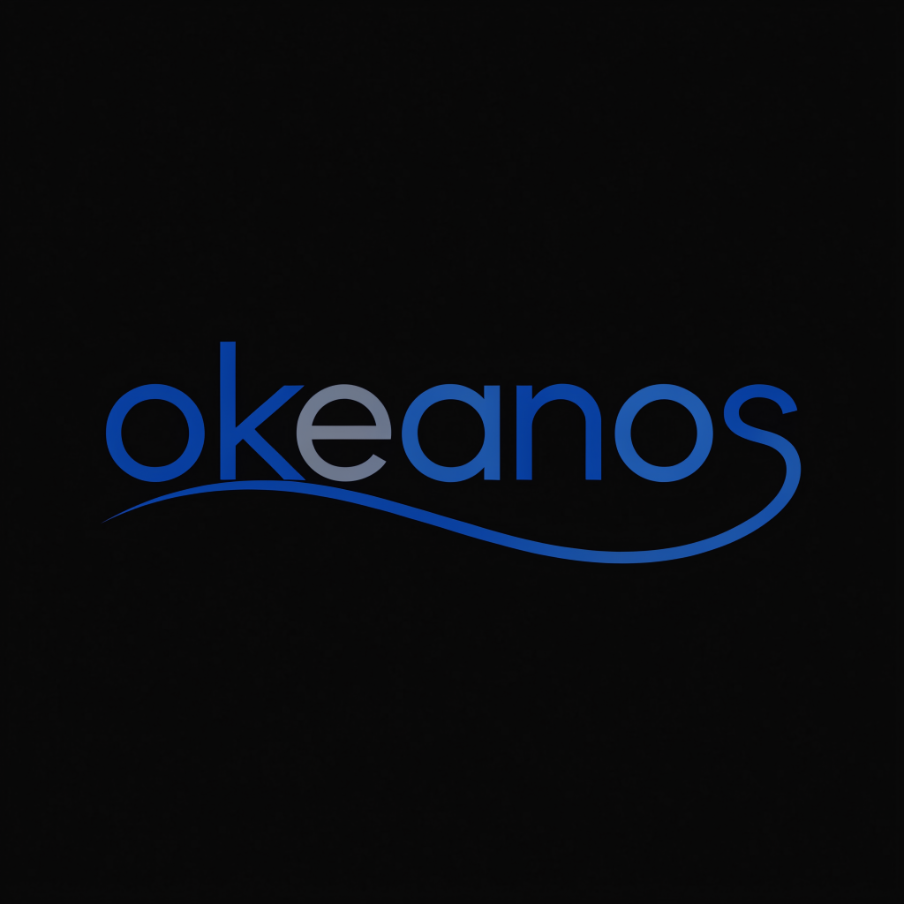

<p align="center">
  
</p>

<h1 align="center">okeanos</h1>

<p align="center">
  A fast, safe-by-default autonomous coding agent in a single Rust binary.
</p>

> **Status:** early and fast-moving (v0.x). Interfaces, config keys and the event schema may change between releases.

## Why okeanos

- **One binary, two front ends.** A terminal TUI and a headless/RPC mode share one code path and one JSON event stream.
- **Safe by default.** Writes, deletes and network calls need approval (allow / deny / allow-always). Every destructive step is preceded by a git snapshot, so `/undo` and `/redo` work.
- **Model-agnostic.** OpenAI-compatible endpoints (e.g. OpenRouter), Anthropic, OpenAI and Google, with named providers. Weak and local models are supported through tiered prompts, text-based tool calling and lenient tool-call parsing.
- **No silent magic.** Hard context cap with a clear error instead of silent truncation. Optional USD budget cap. Token and cost estimates in the status bar.
- **Inspectable.** Every message, tool call, approval and snapshot is appended to a JSONL session log you can resume, replay, export or get stats from.
- **Extensible.** MCP servers (stdio and Streamable HTTP, with OAuth), skills, hooks, agent profiles and sub-agents, and ACP for editor integration.

## Install

Requires the Rust toolchain pinned in [`rust-toolchain.toml`](rust-toolchain.toml).

```sh
git clone https://github.com/edu-diez/okeanos
cd okeanos
cargo install --path .
```

Optional features: `rpc`, `mcp`, `otel`, `markdown` (default: `tui`, `config-file`).

```sh
cargo install --path . --features "mcp rpc markdown"
```

## Quick start

```sh
okeanos init     # write a default okeanos.toml
okeanos doctor   # check config, API keys and dependencies
```

Minimal `~/.config/okeanos/config.toml`:

```toml
[provider]
kind = "openai-compatible"
base_url = "https://openrouter.ai/api/v1"
api_key = "{env:OPENROUTER_API_KEY}"
```

Secrets are referenced with `{env:VAR}` or `{file:path}` and never stored in the file.

```sh
export OPENROUTER_API_KEY=...
okeanos "refactor the auth module"     # one-shot task in the TUI
okeanos --interactive                  # interactive session
okeanos --headless "fix the failing tests"   # JSON events, no TUI (CI, scripts)
okeanos --resume <session-id>          # continue a previous session
```

Run `okeanos --help` for the full flag list.

## Usage notes

| Want to… | Use |
|---|---|
| Undo or redo the agent's last change | `/undo`, `/redo` |
| See the plan and logs | `/todos`, `/logs` |
| List, inspect or replay sessions | `okeanos sessions`, `stats`, `export`, `replay` |
| Trust a project's config and MCP servers | `okeanos trust` |
| Drive it from an editor | `okeanos --acp` |
| Drive it from your own program | `okeanos --rpc` or `--headless` |

Project-local config (`okeanos.toml`, `.mcp.json`, `.okeanos/agents/*.toml`) is only honored after `okeanos trust`.

## Configuration

Global config lives at `~/.config/okeanos/config.toml`; a project `okeanos.toml` (searched up to the git root) overrides it. See [docs/architecture.md](docs/architecture.md) and [docs/design/product-spec.md](docs/design/product-spec.md) for providers, policies, hooks, MCP servers and skills.

## Documentation

Start at the [docs index](docs/README.md).

| Doc | Contents |
|---|---|
| [architecture](docs/architecture.md) | Module layout, control flow, security model |
| [product spec](docs/design/product-spec.md) | Vision, requirements, user stories |
| [TUI design](docs/design/tui-design.md) | Visual design and event-stream map |
| [roadmap](docs/roadmap.md) | Milestones and versioning |
| [CHANGELOG](CHANGELOG.md) | Release history |
| [CONTRIBUTING](CONTRIBUTING.md) | How to contribute |
| [AGENTS](AGENTS.md) | Guidance for AI agents working on this repo |

## Development

```sh
just check          # fmt + clippy + test
just build          # release build
```

Without `just`: `cargo fmt --check && cargo clippy -- -D warnings && cargo test`.

## License

[MIT](LICENSE)
